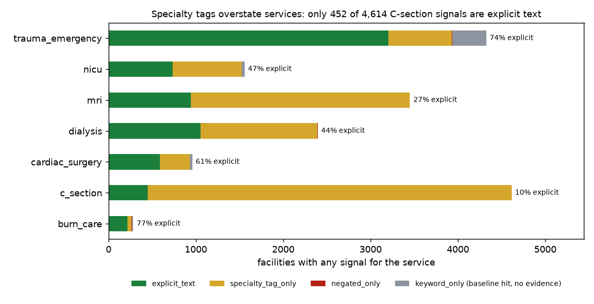
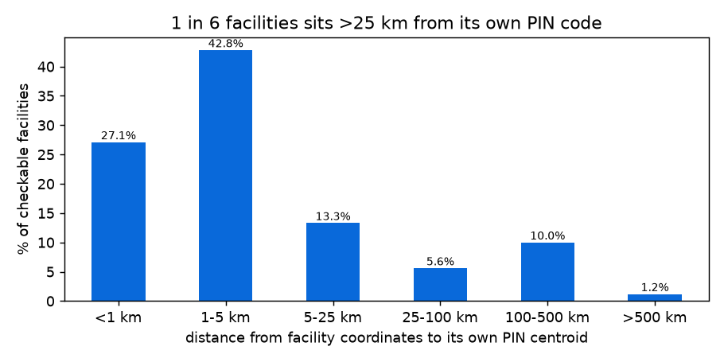
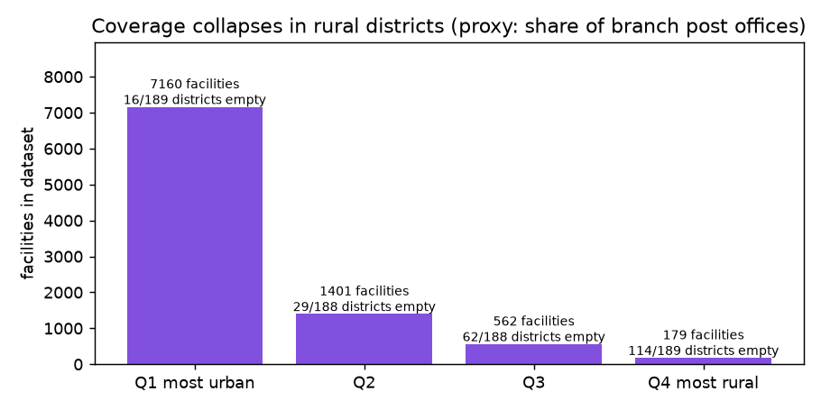
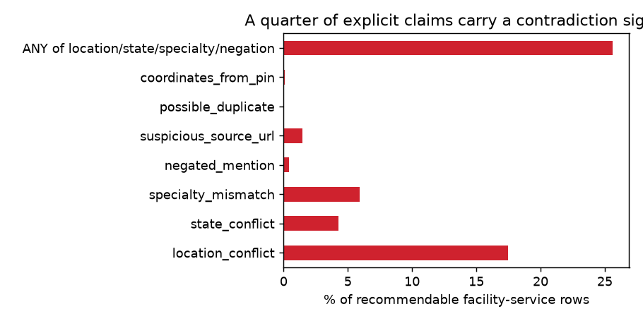

# Data-quality and exploratory analysis report

Generated by `scripts/make_eda_report.py` from the **local CSV exports** (2026-11-21) using `src/careproof/eda.py`. The same functions run on the Marketplace tables in `notebooks/01b_exploratory_analysis.py`; if numbers differ, Databricks is authoritative. Each table answers one question; the caption states the implication for the system. Observations are measured; items marked *proxy* or *hypothesis* are not.

## Q1. Structure, grain and duplicates

| question: structure & duplicates | count |
|---|---|
| raw rows (parsed) | 10088 |
| quarantined: structurally corrupted rows | 88 |
| exact duplicate rows removed | 11 |
| silver facilities | 9989 |
| distinct unique_id in silver | 9989 |
| records sharing exact coordinates with another record | 79 |
| ...of which the co-located records have different names | 79 |
| same normalized name within 1 km (possible duplicate) | 4 |
| content_table_id shared by >1 facility (not an identifier) | 1327 |

*Implication: `unique_id` is a valid key after removing 11 exact duplicates; `content_table_id` is NOT an identifier (shared by unrelated facilities). Co-located records with different names suggest coordinates snapped to a shared point (e.g. a locality centroid), so precise positions cannot be assumed.*

## Q2a. Completeness of evidence fields

| field | pct_missing |
|---|---|
| capacity | 74.9 |
| numberDoctors | 63.7 |
| yearEstablished | 52.2 |
| equipment | 23.2 |
| procedure | 7.8 |
| capability | 0.6 |
| specialties | 0.3 |
| source_urls | 0.3 |
| description | 0.0 |

*Implication: `capacity` and `numberDoctors` are mostly missing and are not evidence of a service anyway; they are excluded from scoring. Description is always present but often short (Q4c).*

## Q2b. Missingness by facility type

| facilityTypeId | n | pct_missing_procedure | pct_missing_equipment | pct_missing_capacity | pct_missing_numberDoctors |
|---|---|---|---|---|---|
| hospital | 5626 | 8.9 | 16.4 | 57.7 | 61.3 |
| clinic | 3782 | 6.2 | 31.9 | 96.7 | 66.4 |
| dentist | 490 | 7.1 | 30.2 | 99.2 | 64.3 |
| null | 57 | 12.3 | 36.8 | 100.0 | 98.2 |
| doctor | 21 | 14.3 | 61.9 | 100.0 | 81.0 |
| farmacy | 10 | 20.0 | 30.0 | 100.0 | 90.0 |

*Implication: clinics and dentists lack equipment lists more often than hospitals; absence of an equipment mention is therefore weak negative evidence and is never penalised.*

## Q2c. Missingness by state

| state | n | pct_missing_procedure | pct_missing_equipment | pct_missing_capacity | pct_missing_numberDoctors |
|---|---|---|---|---|---|
| MAHARASHTRA | 1573 | 6.2 | 24.5 | 75.8 | 60.0 |
| GUJARAT | 980 | 6.6 | 24.2 | 81.0 | 61.8 |
| UTTAR PRADESH | 932 | 7.5 | 20.4 | 77.5 | 64.6 |
| TAMIL NADU | 800 | 9.6 | 25.8 | 72.4 | 65.2 |
| KARNATAKA | 528 | 10.0 | 20.5 | 69.1 | 59.3 |
| KERALA | 481 | 7.3 | 20.6 | 73.0 | 74.6 |
| WEST BENGAL | 476 | 11.3 | 21.2 | 71.6 | 69.1 |
| PUNJAB | 469 | 7.7 | 23.5 | 79.1 | 63.1 |
| HARYANA | 462 | 6.1 | 22.3 | 73.8 | 59.5 |
| TELANGANA | 422 | 7.1 | 26.5 | 75.1 | 56.2 |
| RAJASTHAN | 406 | 5.7 | 20.7 | 73.2 | 66.7 |
| DELHI | 344 | 6.1 | 24.4 | 79.9 | 65.4 |
| ANDHRA PRADESH | 329 | 6.4 | 27.4 | 71.1 | 59.9 |
| (missing) | 316 | 7.0 | 21.2 | 70.9 | 61.4 |
| MADHYA PRADESH | 305 | 9.8 | 26.2 | 73.4 | 58.7 |
| BIHAR | 258 | 11.6 | 22.1 | 70.2 | 74.0 |
| JHARKHAND | 156 | 12.2 | 27.6 | 76.3 | 63.5 |
| CHHATTISGARH | 143 | 10.5 | 25.2 | 67.8 | 64.3 |
| UTTARAKHAND | 125 | 4.8 | 19.2 | 75.2 | 74.4 |
| ODISHA | 118 | 11.9 | 17.8 | 72.9 | 64.4 |
| ASSAM | 117 | 9.4 | 20.5 | 70.9 | 71.8 |

*Implication: missingness varies modestly by state (procedure missing 5-12%); no state is systematically empty, but Bihar/Jharkhand/Odisha are slightly worse.*

## Q2d. Co-missingness (lift > 1 = fields go missing together)

| pair | p_both_missing | p_if_independent | lift |
|---|---|---|---|
| procedure & capability | 0.005 | 0.0 | 10.49 |
| equipment & capability | 0.006 | 0.001 | 4.23 |
| procedure & equipment | 0.051 | 0.018 | 2.81 |
| capability & numberDoctors | 0.005 | 0.004 | 1.46 |
| procedure & numberDoctors | 0.064 | 0.05 | 1.29 |
| capability & capacity | 0.005 | 0.004 | 1.22 |
| equipment & capacity | 0.207 | 0.174 | 1.19 |
| equipment & numberDoctors | 0.164 | 0.148 | 1.11 |
| capacity & numberDoctors | 0.519 | 0.477 | 1.09 |
| procedure & capacity | 0.063 | 0.059 | 1.07 |

*Implication: procedure and capability go missing together far more than chance (lift ~10): missingness is systematic (whole-record extraction failures), not random. Records missing both are a distinct low-evidence group.*

## Q3a. Coordinate validity in each source

| source | coordinate_status | rows | pct |
|---|---|---|---|
| facilities | valid | 9964 | 98.77 |
| facilities | missing | 118 | 1.17 |
| facilities | outside_india | 6 | 0.06 |
| india_post_pincode_directory | valid | 151004 | 91.17 |
| india_post_pincode_directory | missing | 12009 | 7.25 |
| india_post_pincode_directory | outside_india | 1820 | 1.1 |
| india_post_pincode_directory | swapped | 791 | 0.48 |
| india_post_pincode_directory | unparseable | 3 | 0.0 |

*Implication: the PIN directory has ~2,600 unusable coordinates incl. 791 lat/lon swaps; swaps are flagged, never silently corrected, and PIN centroids use outlier-robust medians.*

## Q3b. Facility position vs its own PIN centroid

| facility_to_own_PIN_centroid | n | pct |
|---|---|---|
| <1 km | 2405 | 27.1 |
| 1-5 km | 3797 | 42.8 |
| 5-25 km | 1182 | 13.3 |
| 25-100 km | 496 | 5.6 |
| 100-500 km | 892 | 10.0 |
| >500 km | 109 | 1.2 |

*Implication: 16.8% of facilities are >25 km and 11.2% >100 km from their own PIN centroid. Either the coordinates or the address is wrong (or the record merges facilities). This is the `location_conflict` flag and lowers `location_quality_score`.*

## Q3c. PIN resolvability

| question: PIN resolvability | count |
|---|---|
| PINs | 19586 |
| PINs spanning >1 district | 1258 |
| PINs spanning >1 state | 52 |
| PINs with no valid office coordinates | 36 |
| PINs with geocoded offices that disagree (not defensible) | 2192 |
| PINs with a defensible centroid | 17358 |

*Implication: 2,192 PINs have geocoded offices that disagree; CareProof refuses to place a query at those PINs and asks for coordinates instead of guessing.*

## Q4a. Claims vs explicit evidence per service

| service | explicit_text | negated_only | keyword_only (baseline hit, no evidence) | other_facility_only | specialty_tag_only | explicit_share_of_any_signal_pct |
|---|---|---|---|---|---|---|
| burn_care | 216 | 2 | 16 | 1 | 48 | 76.3 |
| c_section | 449 | 0 | 0 | 0 | 4165 | 9.7 |
| cardiac_surgery | 589 | 2 | 27 | 1 | 340 | 61.4 |
| dialysis | 1052 | 2 | 0 | 0 | 1340 | 43.9 |
| mri | 944 | 2 | 0 | 0 | 2504 | 27.4 |
| nicu | 734 | 0 | 34 | 0 | 788 | 47.2 |
| trauma_emergency | 3201 | 5 | 387 | 3 | 730 | 74.0 |

*Implication: specialty tags overstate services: only 9.8% of facilities with any C-section signal state it explicitly. Tag-only facilities are never recommended.*

## Q4b. Contradiction/data-quality flags among recommendable rows

| flag | candidate_rows | pct_of_candidates |
|---|---|---|
| location_conflict | 1254 | 17.45 |
| state_conflict | 308 | 4.29 |
| specialty_mismatch | 426 | 5.93 |
| negated_mention | 30 | 0.42 |
| suspicious_source_url | 107 | 1.49 |
| possible_duplicate | 4 | 0.06 |
| evidence_list_truncated | 4405 | 61.31 |
| coordinates_from_pin | 7 | 0.1 |
| ANY of location/state/specialty/negation | 1841 | 25.62 |

*Implication: 25.6% of recommendable rows have at least one substantive contradiction (location, state, specialty profile, negation) -> shown as warnings and penalties, not hidden. 61% hit the 50-item array cap, so evidence lists may be truncated (missing-data warning, no penalty).*

## Q4c. Description quality and script

| question: description quality | value |
|---|---|
| descriptions present | 9989 |
| median words | 16 |
| p10 / p90 words | 5 / 55 |
| descriptions with <= 10 words | 2838 |
| contain any non-ASCII character | 597 |
| contain Devanagari script | 9 |

*Implication: descriptions are short (median 16 words) and essentially English-only (9 contain Devanagari); facilities described only in Indian languages would be missed -> language/source bias.*

## Q4d. Most-cited source domains

| domain | facilities_citing | pct_facilities |
|---|---|---|
| facebook.com | 8840 | 88.5 |
| justdial.com | 5425 | 54.3 |
| practo.com | 2705 | 27.1 |
| mappls.com | 1678 | 16.8 |
| medindia.net | 1543 | 15.4 |
| onefivenine.com | 1464 | 14.7 |
| proptiger.com | 1141 | 11.4 |
| in.linkedin.com | 1093 | 10.9 |
| policyx.com | 1031 | 10.3 |
| lybrate.com | 935 | 9.4 |
| indiamart.com | 865 | 8.7 |
| docindia.org | 835 | 8.4 |

*Implication: evidence comes predominantly from social media and aggregators (Facebook 88%, Justdial 54%), not official registries. Claims must be treated as self-reported.*

## Q5a. Least reliable NFHS indicators

| indicator | n | suppressed | small_sample | pct_unreliable |
|---|---|---|---|---|
| child_6_8m_receiving_solid_or_semi_solid_food_and_breastmil_pct | 706 | 642 | 62 | 99.7 |
| non_breastfeeding_child_6_23m_receiving_an_adequate_diet16_pct | 706 | 643 | 59 | 99.4 |
| children_with_diarrhoea_2wk_taken_to_a_health_facility_or_h_pct | 706 | 492 | 162 | 92.6 |
| children_with_diarrhoea_2wk_who_received_oral_rehydration_s_pct | 706 | 492 | 162 | 92.6 |
| children_with_diarrhoea_2wk_who_received_zinc_child_u5_pct | 706 | 492 | 162 | 92.6 |
| child_u6m_exclusively_breastfed_pct | 706 | 261 | 347 | 86.1 |
| children_born_at_home_who_were_taken_to_a_health_facility_f_pct | 706 | 422 | 141 | 79.7 |
| pregnant_w15_49_who_are_anaemic_lt_11_0_g_dl_22_pct | 706 | 134 | 421 | 78.6 |
| children_with_fever_or_symptoms_of_ari_2wk_taken_to_a_healt_pct | 706 | 224 | 264 | 69.1 |
| child_12_23m_fully_vaccinated_based_on_information_from_vax_pct | 706 | 22 | 323 | 48.9 |
| births_in_a_private_fac_that_were_delivered_by_csection_5y_pct | 706 | 150 | 122 | 38.5 |
| child_12_23m_who_received_most_of_their_vaccinations_in_a_2_pct | 706 | 16 | 252 | 38.0 |

*Implication: several NFHS indicators are mostly suppressed or small-sample; CareProof shows only service-relevant indicators, with raw values and flags, as district context.*

## Q5b. NFHS percentage indicators outside [0,100]

_No rows (check passed)._

*Implication: no percentage indicator is outside [0,100] after parsing.*

## Q5c. NFHS geographic join coverage

| question: NFHS geographic join | value |
|---|---|
| NFHS districts | 706.0 |
| matched to India Post district+state | 598.0 |
| match rate % | 84.7 |
| NFHS rows with unrecognised state | 0.0 |

*Implication: 84.7% of NFHS districts match an India Post district by normalized name+state; unmatched districts (renamed/split districts) get no context rather than a fuzzy guess.*

## Q6a. Coverage by district rurality (BO-share proxy)

| rurality_quartile | districts | median_bo_share | districts_with_zero_facilities | total_facilities | median_facilities_per_district | mean_pct_with_explicit_evidence | mean_pct_location_conflict |
|---|---|---|---|---|---|---|---|
| Q1 most urban | 189 | 0.758 | 16 | 7160.0 | 18.0 | 40.2 | 18.4 |
| Q2 | 188 | 0.859 | 29 | 1401.0 | 3.5 | 44.1 | 24.7 |
| Q3 | 188 | 0.896 | 62 | 562.0 | 1.0 | 49.6 | 35.7 |
| Q4 most rural | 189 | 0.936 | 114 | 179.0 | 0.0 | 35.9 | 28.2 |

*Implication: the most rural quartile of districts (proxy) contains 2.0% of facilities and 114 of 189 such districts have none. Recommendations there will be far away or absent: CareProof must abstain honestly and flag coverage, and benchmark results on urban queries do not generalise to rural ones.*

## Q6b. Explicitly evidenced facilities per service, by state

| state | burn_care | c_section | cardiac_surgery | dialysis | mri | nicu | trauma_emergency | facilities_total |
|---|---|---|---|---|---|---|---|---|
| MAHARASHTRA | 33 | 71 | 108 | 134 | 123 | 95 | 422 | 1573 |
| GUJARAT | 18 | 26 | 31 | 73 | 60 | 51 | 284 | 980 |
| UTTAR PRADESH | 31 | 56 | 42 | 104 | 69 | 112 | 355 | 932 |
| TAMIL NADU | 9 | 42 | 53 | 107 | 70 | 49 | 267 | 800 |
| KARNATAKA | 11 | 24 | 33 | 51 | 64 | 42 | 165 | 528 |
| KERALA | 7 | 10 | 39 | 56 | 51 | 34 | 160 | 481 |
| WEST BENGAL | 13 | 26 | 32 | 69 | 67 | 33 | 124 | 476 |
| PUNJAB | 13 | 20 | 22 | 51 | 42 | 21 | 167 | 469 |
| HARYANA | 15 | 34 | 29 | 52 | 61 | 34 | 157 | 462 |
| TELANGANA | 8 | 16 | 26 | 37 | 55 | 22 | 135 | 422 |
| RAJASTHAN | 3 | 21 | 27 | 37 | 36 | 39 | 156 | 406 |
| DELHI | 3 | 14 | 10 | 17 | 23 | 14 | 71 | 344 |
| ANDHRA PRADESH | 3 | 12 | 36 | 27 | 29 | 21 | 132 | 329 |
| (unrecognised) | 5 | 17 | 20 | 42 | 31 | 32 | 112 | 316 |
| MADHYA PRADESH | 18 | 11 | 12 | 28 | 25 | 26 | 101 | 305 |
| BIHAR | 6 | 12 | 10 | 39 | 29 | 35 | 101 | 258 |
| JHARKHAND | 3 | 7 | 9 | 27 | 17 | 12 | 52 | 156 |
| CHHATTISGARH | 7 | 11 | 8 | 18 | 12 | 8 | 54 | 143 |
| UTTARAKHAND | 4 | 3 | 10 | 16 | 17 | 16 | 43 | 125 |
| ODISHA | 1 | 2 | 10 | 14 | 19 | 8 | 38 | 118 |
| ASSAM | 2 | 6 | 7 | 18 | 15 | 10 | 31 | 117 |
| JAMMU AND KASHMIR | 1 | 1 | 6 | 10 | 8 | 6 | 15 | 62 |
| CHANDIGARH | 0 | 1 | 1 | 3 | 3 | 2 | 7 | 46 |
| HIMACHAL PRADESH | 0 | 2 | 0 | 6 | 5 | 2 | 18 | 38 |
| GOA | 1 | 2 | 2 | 4 | 2 | 3 | 11 | 32 |

*Implication: absolute counts of explicitly evidenced providers are small outside the large states (e.g. Odisha: 2 C-section, 1 burn care). Absence in this dataset is not absence on the ground.*
